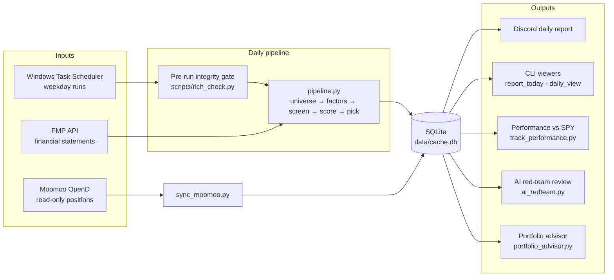
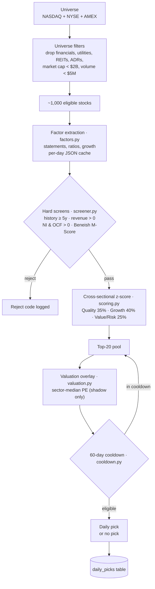

# RICH — Automated US-Equity Recommender

RICH is a fully automated, rules-based stock picker. Every trading day it pulls fundamentals for the US market, screens ~1,000 eligible stocks down to **one** recommendation (or none, when nothing clears every quality gate), and logs every score, flag and reject reason to SQLite for full auditability.

RICH produces recommendations, not orders. It has no connection to any brokerage or execution system.

**Stack:** Python 3.13 · SQLite · Financial Modeling Prep (FMP) API · Windows Task Scheduler · Claude API (optional AI red-team review)

---

## System overview



---

## Daily pipeline (logical flow)



Shadow signals (valuation overlay, Taleb fragility/longevity metrics) are computed and stored but do not change the pick until promoted under the governance rules in [docs/RICH_METHODOLOGY_AND_STATUS.md](docs/RICH_METHODOLOGY_AND_STATUS.md).

---

## Repository map

| Area | Files | Role |
|---|---|---|
| **Entry points** | `run_daily.py`, `run_daily.bat`, `run_rich_daily_pipeline.cmd` | Daily run (pre-check gate, then pipeline) |
| **Pipeline core** | `pipeline.py`, `universe.py`, `factors.py`, `screener.py`, `scoring.py`, `valuation.py`, `cooldown.py`, `config.py` | Universe → factors → screens → scoring → pick |
| **Models** | `beneish.py`, `piotroski.py` | Beneish M-Score (manipulation gate), Piotroski F-Score (quality) |
| **Data layer** | `data/fetcher.py`, `data/storage.py` | FMP client with retries and caching; SQLite schema and migrations |
| **Reporting** | `report_today.py`, `daily_view.py`, `rank_shift_reviewer.py`, `discord_daily_report.py`, `make_xle_report.py` | Read-only views and daily notifications |
| **Performance & portfolio** | `track_performance.py`, `portfolio.py`, `run_portfolio.py`, `portfolio_advisor.py`, `sync_moomoo.py` | Returns vs SPY; read-only portfolio engine and Moomoo sync |
| **AI & research** | `ai_redteam.py`, `factor_analysis.py`, `bgtest/` | Claude-based red-team critique of each pick; factor IC analysis; background-research shadow run |
| **Governance & ops** | `governance.py`, `scripts/`, `logging_utils.py`, `run_log.py`, `validate_cache.py`, `run_backfill.py` | Shadow-signal report, scheduler install, logging, cache checks, backfills |
| **Tests** | `test_*.py` | Unit and end-to-end tests |
| **Docs** | `docs/` | Methodology, status, vision and operating principles |

---

## Getting started

```bash
pip install -r requirements.txt
cp .env.example .env          # add FMP_API_KEY=<your_key>

python run_daily.py           # full daily run (also run by Task Scheduler)
python report_today.py        # show today's pick
python track_performance.py   # update returns vs SPY
python ai_redteam.py          # optional: AI red-team review (needs ANTHROPIC_API_KEY)
```

Typical runtime is 10–15 minutes, dominated by FMP API calls; a same-day rerun finishes in about a second thanks to the per-day cache.

---

## Status

| Phase | Description | Status |
|---|---|---|
| 1 | Universe hardening (sector exclusion, ADR guard) | ✅ Live |
| 2 | Beneish M-Score hard gate | ✅ Live |
| 3 | Quality / Growth / Value-Risk scoring sleeves | ✅ Live |
| 4 | Cross-sectional z-score normalisation | ✅ Live |
| 5 | Portfolio engine | 🔵 Read-only |
| 6 | Performance tracking vs SPY | ✅ Live |
| — | Valuation overlay (sector-median PE) | 🔵 Shadow |

## Documentation

- [Methodology & implementation status](docs/RICH_METHODOLOGY_AND_STATUS.md) — the best starting point; read it before the code.
- [Vision & mission](docs/RICH_VISION_AND_MISSION.md) · [Operating principles](docs/RICH_OPERATING_PRINCIPLES.md) · [Project status](docs/PROJECT_STATUS.md)

---

*Disclaimer: RICH is a personal research project. Its output is not investment advice.*
